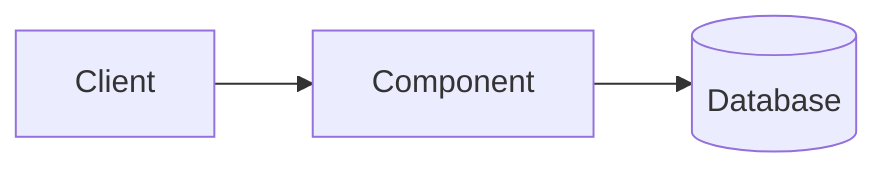

# NN. Topic Name

> [!IMPORTANT]
> **📌 Key takeaway:** one sentence that sums up the topic in plain words.
>
> - The most important point
> - The second most important point
> - The one thing to remember for an interview

<!-- Write the key takeaway yourself first, then polish it. One sentence + max 3 bullets. -->

📅 **Date:** YYYY-MM-DD

📚 **Resources:**

- [Descriptive link title, not "click here"](link)

## ✍️ In my own words

<!-- Write this yourself BEFORE reading polished notes or asking AI.
     Pretend you're explaining it to a teammate in 30 seconds. 2–3 sentences. -->

## 🗺️ Diagram

<!-- Optional. Keep it small. Always include accTitle, accDescr and a text version. -->

**Text version:** Client sends a request to the component, which reads from the database.

## 🔑 Key ideas

-
-
-

## 🧪 Examples

-
-

<!-- Add at least one example from your own work if you can (Prime Video, CITMIT, Army, projects). -->

**From my own work:**

-

## 🎯 When to use it

-
-

## ⚖️ Trade-offs

| Aspect | Option A | Option B |
|---|---|---|
|  |  |  |

## ☁️ On AWS

- Which AWS service does this map to? Spell out the name the first time, e.g. "RDS (Relational Database Service)".

## 🛠️ Try it

<!-- One small hands-on step (10–20 min). Write what you did and what you saw. -->

- [ ] Task:
- What I saw:

## 🎤 Interview one-liner

> How I'd explain it in 2–3 sentences.

## 🧠 Self-check

<!-- 3 questions. Hide each answer in a 
 box so you can quiz yourself. -->

1. Question?
   

Answer

   Answer here.

   

## 🔗 Related topics

- [NN. Topic](NN-topic.md)

## ❓ Questions I still have

-

## 🔁 Review log

<!-- Add a line each time you come back to this note. -->

| Date | What I added or changed |
|---|---|
| YYYY-MM-DD | First notes |
