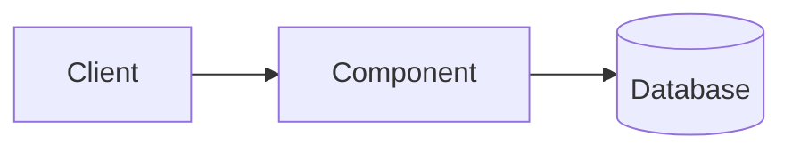

# NN. Topic Name

**Date:** YYYY-MM-DD
**Resources:**
- [Title](link)

## In one sentence

What is it, in plain words?

## Diagram (optional)

Use a simple Mermaid diagram if it helps. GitHub draws it automatically.

## Key ideas

-
-
-

## Examples

-
-

## When to use it

-
-

## Trade-offs

| Pros | Cons |
|---|---|
|  |  |

## On AWS

- Which AWS service does this map to?

## Interview one-liner

> How I'd explain it in 2–3 sentences.

## Questions I still have

-
