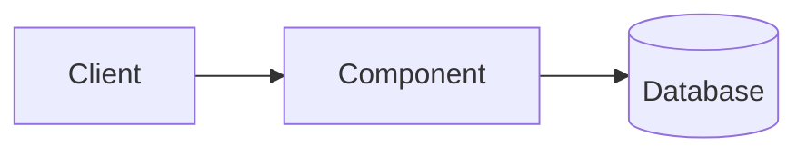

# NN. Topic Name

> [!IMPORTANT]
> **📌 Key takeaway:** one sentence that sums up the topic in plain words.
>
> - The most important point
> - The second most important point
> - The one thing to remember for an interview

📅 **Date:** YYYY-MM-DD

📚 **Resources:**

- [Descriptive link title, not "click here"](link)

## 🗺️ Diagram

**Text version:** Client sends a request to the component, which reads from the database.

## 🔑 Key ideas

-
-
-

## 🧪 Examples

-
-

## 🎯 When to use it

-
-

## ⚖️ Trade-offs

| Aspect | Option A | Option B |
|---|---|---|
|  |  |  |

## ☁️ On AWS

- Which AWS service does this map to? Spell out the name the first time, e.g. "RDS (Relational Database Service)".

## 🎤 Interview one-liner

> How I'd explain it in 2–3 sentences.

## ❓ Questions I still have

-
