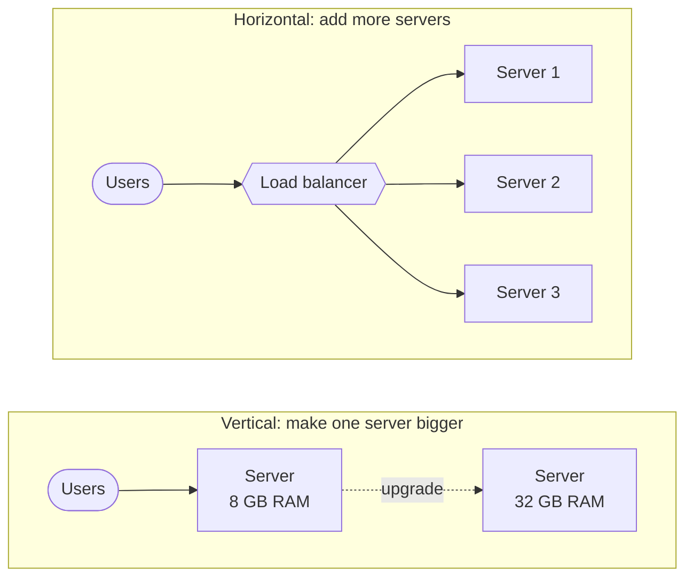
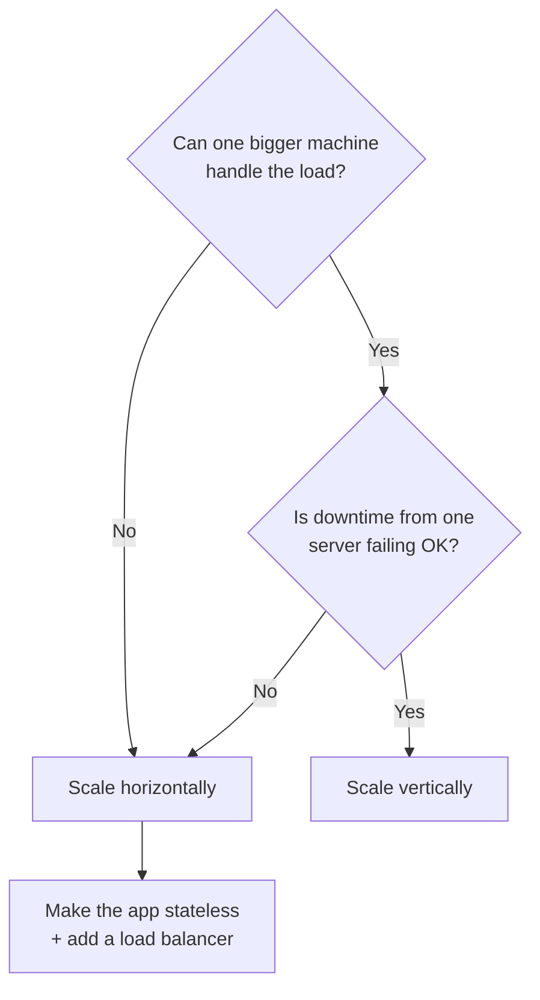

# 02. Horizontal vs Vertical Scaling

**Date:** 2026-11-06
**Resources:**
- [GeeksforGeeks: Horizontal and Vertical Scaling](https://www.geeksforgeeks.org/system-design/system-design-horizontal-and-vertical-scaling/)
- (The original task link didn't work, so I used this one instead.)

## In one sentence

Scaling means giving a system more capacity: **vertical** makes one machine bigger, **horizontal** adds more machines.

## Diagram

## Key ideas

- **Vertical scaling (scale up):** add more CPU, RAM or storage to the **same** server.
  - Easy: the app usually doesn't need to change.
  - Has a ceiling: you can only buy a machine so big.
  - Still one machine, so if it goes down, everything goes down.
- **Horizontal scaling (scale out):** add **more** servers and spread the work across them.
  - A **load balancer** sends each request to one of the servers.
  - No hard ceiling: keep adding servers as traffic grows.
  - Harder: the app must work across many machines (shared sessions, keeping data in sync).
- **Scaling ≠ reliability.** Adding capacity doesn't automatically make a system fault tolerant. Horizontal scaling makes redundancy *possible*, but you still have to design for it.
- **Most real systems mix both**, choosing per component. For example: scale the web servers out, and scale the database up.

## Examples

- **Vertical:** a small app is slow, so you upgrade its server from 8 GB to 32 GB of RAM.
- **Horizontal:** an online store adds more web servers before a big sale, then removes them afterward.
- **Analogy:** vertical = replacing your car with a bigger truck. Horizontal = adding more cars to the fleet.

## Which one should I pick?

## When to use it

**Vertical when:**
- The system is small or medium, and one bigger machine can handle the load.
- You need more capacity **quickly** with minimal changes.
- The component is hard to split, like a traditional relational database.

**Horizontal when:**
- Traffic could outgrow any single machine.
- You need **redundancy**, so one server failing doesn't take the site down.
- Traffic goes up and down, so you want to add and remove capacity (elastic).
- The app is **stateless**, meaning any server can handle any request.

## Trade-offs

| | Vertical (scale up) | Horizontal (scale out) |
|---|---|---|
| How | Bigger machine | More machines |
| Limit | Biggest machine available | Add nodes as needed |
| Complexity | Low | Higher (load balancing, data sync) |
| Failure | One machine = single point of failure | Can survive a node failing |
| Downtime | Upgrades may need a restart | Add nodes without downtime |
| Cost | Gets expensive fast at the high end | Grows step by step |

## On AWS

- **Vertical:** change an EC2 instance type (e.g. `t3.medium` → `m5.xlarge`), or move an RDS database to a larger instance class.
- **Horizontal:** an **Auto Scaling group** of EC2 instances behind an **Application Load Balancer**; **RDS read replicas** to spread read traffic.
- **Managed services that scale out for you:** DynamoDB, S3 and Lambda handle horizontal scaling automatically.

## Interview one-liner

> "Vertical scaling means upgrading one machine. It's simple but has a ceiling and a single point of failure. Horizontal scaling means adding machines behind a load balancer. It scales further and allows redundancy, but the app has to be stateless and data has to stay consistent. In practice I'd scale stateless web servers horizontally and often scale the database vertically first, adding read replicas or sharding when one machine isn't enough."

## Questions I still have

- How do you keep user sessions working when requests hit different servers? (sticky sessions vs. storing sessions in Redis)
- When does a database need sharding instead of a bigger machine? (→ topic 10)
