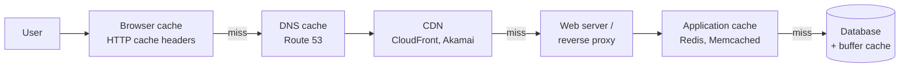
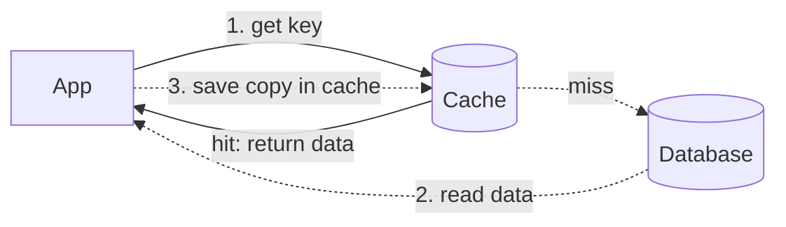
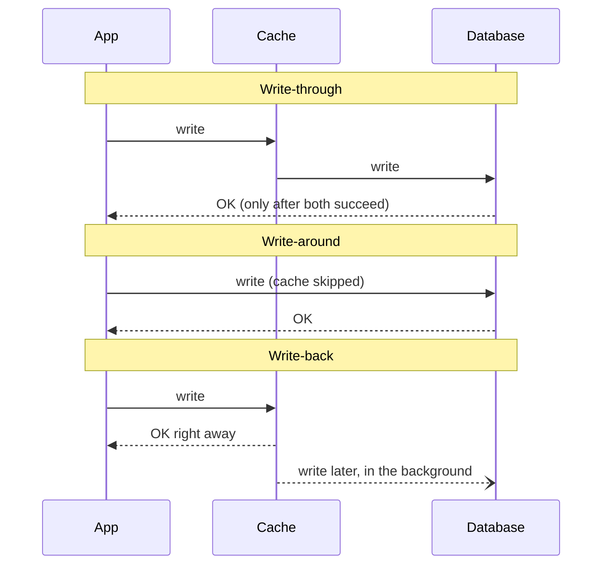
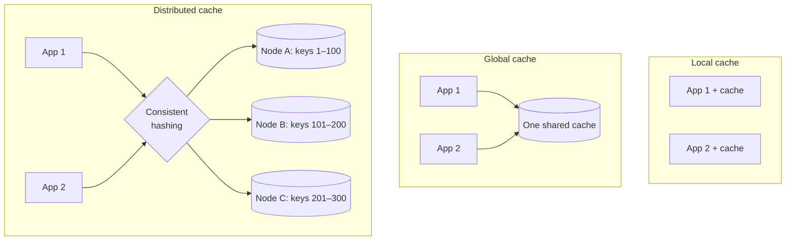

# Caching

> [!IMPORTANT]
> **📌 Key takeaway:** a cache keeps a copy of frequently used data in a small, fast place, so most requests never reach the slow original source.
>
> - Caches exist at every layer: browser, DNS, CDN, web server, application, database, and even the CPU.
> - The hard part is keeping the copy correct: pick a write policy (write-through, write-around, write-back) that fits your reads and writes.
> - The cache is small, so an eviction policy (usually LRU) decides what to throw out when it's full.

📅 **Date:** 2026-11-09

📚 **Resources:**

- [Larry Peng Yang: System Design — Caching (Medium)](https://medium.com/must-know-computer-science/system-design-caching-acbd1b02ca01)

## ✍️ In my own words

<!-- Write this yourself BEFORE reading the polished notes or asking AI.
     Pretend you're explaining it to a teammate in 30 seconds. 2–3 sentences. -->

_✏️ To be written by me._

## 🗺️ Diagram

**Where caches live.** A request can be answered by a cache at any of these layers before it reaches the database.

**Text version:** the browser checks its own cache first. DNS answers are cached too. Static files are served by a CDN close to the user. Dynamic requests reach the web server, which checks an application cache like Redis. Only on a miss does the request reach the database, which also caches hot pages in memory.

**Reading through a cache (cache hit vs cache miss):**

**Text version:** the app asks the cache first. Hit → return the data immediately. Miss → read from the database, put a copy in the cache, then return it. The next request for the same key is a hit.

## 🔑 Key ideas

- **Locality of reference:** data that was requested recently is likely to be requested again. Caching is built on this.
- **A cache is short-term memory:** small, limited space, but much faster than the original source.
- **Three ways to use a cache:**
  1. Precalculate results (for example, yesterday's visit count per referring site).
  2. Pre-generate expensive indexes (for example, suggested stories based on a user's clicks).
  3. Keep copies of hot data in a faster store (for example, Memcached in front of PostgreSQL).
- **Caches are usually found close to the front end**, because the earlier a request is answered, the less work every layer behind it does.
- **Cache invalidation:** when data changes in the database, the cached copy must be updated or removed, or users see stale (old) data.
- **Write policy** decides how writes reach the cache and the database. **Eviction policy** decides what gets removed when the cache is full.

### Why caches are fast

Rough, order-of-magnitude numbers (general reference values, not from the article). Each step down is roughly 10× to 1,000× slower.

| Where the data is | Rough time to read | Compared to RAM |
|---|---|---|
| CPU L1 cache | ~1 nanosecond | ~100× faster |
| RAM (in-memory cache like Redis on the same machine) | ~100 nanoseconds | 1× |
| Redis over the network in the same data center | ~0.5 milliseconds | ~5,000× slower |
| SSD read (database on disk) | ~0.1–1 milliseconds per read, more per query | ~1,000–10,000× slower |
| Request to another continent | ~150 milliseconds | ~1,500,000× slower |

### Cache layers

| Layer | What it speeds up | Technology | Example solutions |
|---|---|---|---|
| Client (browser or device) | Loading web content | HTTP cache headers, the browser itself | Built into every browser |
| DNS (Domain Name System) | Turning a domain name into an IP address | DNS servers | Amazon Route 53 |
| Web server | Web content and server-side sessions | HTTP cache headers, CDNs, reverse proxies, key-value stores | CloudFront, ElastiCache for Redis or Memcached |
| Application | App performance and data access | Key-value stores, local in-process caches | Redis, Memcached |
| Database | Query latency | Database buffers, key-value stores | Built-in buffer cache (tune it), Redis, Memcached |
| CDN (Content Delivery Network) | Static files (images, video, JS, CSS), served near the user | Edge servers around the world | Amazon CloudFront, Akamai |
| Hardware and OS | Everything | CPU caches (L1/L2/L3), GPU cache, OS page cache (disk cache) | Managed by hardware or the OS kernel |

**No CDN yet?** Serve static files from a separate subdomain with a lightweight server (Nginx, Apache). Later, point that subdomain's DNS at a CDN, with no app changes.

### Write policies (keeping the cache and database in sync)

**Text version:** write-through writes to the cache and the database, and confirms only when both succeed. Write-around writes only to the database and skips the cache. Write-back writes only to the cache, confirms immediately, and syncs to the database later.

| Policy | How a write works | Pros | Cons | Good for |
|---|---|---|---|---|
| **Write-through** | Write to cache **and** database; success only when both succeed | Cache and database always match; reads are fast; survives crashes | Slower writes (two writes every time) | Data that's read right after it's written and must be correct |
| **Write-around** | Write only to the database; cache is skipped | Writes are fast; cache isn't filled with data nobody reads | Reading just-written data is a cache miss, so it's slow | Data that's written once and rarely read again (logs, archives) |
| **Write-back** (write-behind) | Write only to the cache; synced to the database later | Fastest writes, highest write throughput | **Data loss risk** if the cache dies before syncing (fix: replicate the cache) | Write-heavy apps that can tolerate some risk (counters, likes, metrics) |

### Eviction policies (what to remove when the cache is full)

| Policy | Removes first | In one line |
|---|---|---|
| **FIFO** (First In, First Out) | The item added earliest | A queue; ignores how often items are used |
| **LIFO** (Last In, First Out) | The item added most recently | A stack; ignores how often items are used |
| **LRU** (Least Recently Used) | The item not used for the longest time | The common default: old, untouched data goes first |
| **MRU** (Most Recently Used) | The item used most recently | Opposite of LRU; useful when a just-used item won't be needed again (e.g. scanning a big file once) |
| **LFU** (Least Frequently Used) | The item used the fewest times | Keeps long-term popular items, even if not used lately |
| **RR** (Random Replacement) | A random item | Simple and cheap; no tracking needed |

### Local vs global vs distributed cache

When the app runs on many servers behind a load balancer, a **local cache on each server** causes problems: the same request can land on different servers (more misses), and the same data gets stored on several servers (wasted memory).

**Text version:** local caches live inside each app server and duplicate data. A global cache is one shared cache server for all app servers. A distributed cache splits the data across several cache nodes; a hash of the key tells you which node holds it.

| Setup | How it works | Pros | Cons |
|---|---|---|---|
| Local | Each app server keeps its own cache in memory | Fastest (no network hop) | Duplicated data; more misses as servers are added |
| Global | All app servers share one cache server | Simple; one copy of each item | Can be overwhelmed as traffic grows; a single point of failure |
| Distributed | Cache split across nodes with consistent hashing | Grows by adding nodes | Losing a node loses its data (fix: store copies on several nodes) |

**Who handles a miss in a global cache?** Usually the cache server fetches from the database itself. The app handles it instead when most hot data is already cached, the cached files are static and shouldn't be evicted, or the app knows the hot spots better than the cache does.

### Designing a cache yourself (interview classic)

- An LRU cache = **hash map + doubly linked list**. The map finds a key in O(1); the list keeps items in "recently used" order, and a doubly linked list makes removing an item O(1) too.
- For very high traffic (the article's example: 1 million queries per second on one machine), add **leader–follower replication** (the article says "master-slave") so a copy survives if one node fails.

## 🧪 Examples

- **Browser:** a site sends `Cache-Control: max-age=86400` so your browser reuses its logo for a day.
- **CDN:** Netflix-style video and images served from an edge server in your city instead of the origin.
- **Application:** a Redis cache in front of PostgreSQL holding user profiles or product pages.
- **Database:** PostgreSQL's shared buffers keep hot table pages in RAM.
- **OS:** Linux's page cache keeps recently read files in memory, which is why the second `cat` of a big file is instant.

**From my own work:**

- _✏️ To be written by me._

## 🎯 When to use it

- Data is **read much more than it's written** (product pages, profiles, configs).
- The same results are **expensive to compute** (aggregates, recommendations, rendered pages).
- You need **lower latency** or need to **protect the database** from load spikes.
- You serve **static files to users worldwide** → CDN.
- **Avoid or be careful** when data must always be perfectly fresh (account balances) or every request is unique (little reuse means a low hit rate).

## ⚖️ Trade-offs

| Aspect | With a cache | Without a cache |
|---|---|---|
| Read speed | Very fast on a hit | Every read goes to the database |
| Database load | Much lower | Database handles everything |
| Freshness | Risk of stale data; needs invalidation | Always up to date |
| Complexity | More moving parts (write policy, eviction, failures) | Simpler |
| Cost | Extra memory and servers | Bigger database instead |
| Failure | Cache outage can send a flood of traffic to the database | — |

## ☁️ On AWS

- **ElastiCache** (Redis or Memcached) for application and database caching; **MemoryDB** when you need Redis with durability.
- **DAX (DynamoDB Accelerator)** as a write-through cache in front of DynamoDB.
- **CloudFront** as the CDN for static and dynamic content.
- **Route 53** for DNS, which caches answers based on their TTL (Time To Live).
- **API Gateway** can cache responses for API stages.

## 🛠️ Try it

- [ ] Task: run Redis locally (`docker run -p 6379:6379 redis`), then in `redis-cli`: `SET user:1 "Alice" EX 10`, `GET user:1`, wait 10 seconds, `GET user:1` again. Then set `maxmemory 1mb` and `maxmemory-policy allkeys-lru`, fill it with keys, and check which keys were evicted.
- What I saw:

## 🎤 Interview one-liner

> "A cache stores hot data in a fast layer, like Redis in front of a database or a CDN in front of my servers, so most reads skip the slow source. I pick a write policy based on the workload: write-through when reads must be fresh, write-around for data that's rarely re-read, and write-back for write-heavy data where a little risk is OK. When the cache fills up, LRU eviction is the usual default, and with many app servers I use a distributed cache with consistent hashing instead of local caches."

## 🧠 Self-check

1. A social app counts post likes and gets thousands of writes per second. Which write policy fits, and what's the risk?
   

Answer

   Write-back: writes go only to the cache and are synced later, giving the fastest writes. The risk is losing recent likes if the cache crashes before syncing; replicating the cache reduces it.

   

2. You have 10 app servers behind a load balancer, each with its own local cache. What two problems appear, and what fixes them?
   

Answer

   The same request can hit different servers (more cache misses), and the same data is stored many times (wasted memory). A global cache or a distributed cache fixes both.

   

3. Which data structures make an LRU cache O(1) for both get and put?
   

Answer

   A hash map (find the key) plus a doubly linked list (keep usage order and remove or move items in O(1)).

   

## 🔗 Related topics

- [Database Types](database-types.md) (Redis and Memcached are in-memory key-value stores)
- [Horizontal vs Vertical Scaling](horizontal-vs-vertical-scaling.md)
- Distributed Caching (not written yet)
- Load Balancing (not written yet)
- Consistent Hashing (not written yet)

## ❓ Questions I still have

- What is cache-aside (lazy loading), and how is it different from the three write policies?
- How do I choose a good TTL (Time To Live)?
- What's a "thundering herd" (cache stampede), and how do you prevent it when a hot key expires?
- How does consistent hashing keep most keys in place when a node is added or removed? (Future note: Distributed Caching.)

## 🔁 Review log

| Date | What I added or changed |
|---|---|
| 2026-11-09 | First notes |
