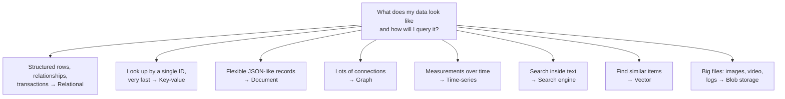

# Database Types

> [!IMPORTANT]
> **📌 Key takeaway:** there's no single best database; pick the one whose data model matches how your data looks and how you'll query it.
>
> - Relational (SQL) is the safe default for structured data, relationships and transactions.
> - NoSQL types (key-value, document, wide-column, graph) trade some query power or consistency for scale and flexibility.
> - Specialized types exist for one job each: time-series, search, vectors, files (blobs), and so on.

📅 **Date:** 2026-11-06

📚 **Resources:**

- [AlgoMaster: 15 Types of Databases and When to Use Them](https://blog.algomaster.io/p/15-types-of-databases)

## ✍️ In my own words

<!-- Write this yourself BEFORE reading the polished notes or asking AI.
     Pretend you're explaining it to a teammate in 30 seconds. 2–3 sentences. -->

_✏️ To be written by me._

## 🗺️ Diagram

**Text version:** start with what your data looks like and how you'll query it. Structured data with relationships → relational. Lookups by ID → key-value. Flexible records → document. Connected data → graph. Time-stamped measurements → time-series. Text search → search engine. Similarity search → vector. Large files → blob storage.

## 🔑 Key ideas

- **Relational (RDBMS):** tables of rows and columns, linked by keys. Uses SQL (Structured Query Language) and supports **ACID** transactions (Atomicity, Consistency, Isolation, Durability), so a money transfer either fully happens or doesn't happen at all.
- **NoSQL** is a family, not one thing. Each type gives up something (joins, strict consistency or a fixed schema) to gain speed, scale or flexibility.
- **Match the database to the access pattern.** Ask: "How will I read and write this data?" before "Which database is popular?"
- **Real systems use several databases**, each for the job it's best at. This is called *polyglot persistence*. Example: SQL for orders, Redis for sessions, Elasticsearch for product search, S3 for images.
- **Older or niche types** (hierarchical, object-oriented, embedded) still exist, but you'll mention them far less in interviews.

## 🧪 Examples

| Type | Stores data as | Best for | Examples | On AWS |
|---|---|---|---|---|
| Relational | Tables with rows and columns | Orders, payments, employee records | MySQL, PostgreSQL | RDS, Aurora |
| Key-value | Key → value pairs | Sessions, caching, shopping carts | Redis, DynamoDB | DynamoDB, ElastiCache |
| Document | JSON-like documents | Product catalogs, user profiles | MongoDB, Couchbase | DocumentDB |
| Wide-column | Rows with flexible columns, spread across many machines | Huge write volumes, event logs, analytics | Cassandra, HBase, Bigtable | Keyspaces |
| Graph | Nodes and edges (relationships) | Social networks, recommendations, fraud rings | Neo4j | Neptune |
| In-memory | Data kept in RAM | Caching, game state, leaderboards | Redis, Memcached | ElastiCache, MemoryDB |
| Time-series | Values with timestamps | Metrics, IoT sensors, stock prices | InfluxDB, Prometheus | Timestream |
| Text search | Indexed text | Product search, log search | Elasticsearch, Solr | OpenSearch |
| Spatial | Points, lines, shapes on a map | "Restaurants near me", route planning | PostGIS | RDS for PostgreSQL + PostGIS |
| Blob storage | Large files (binary objects) | Images, videos, backups, data lakes | Azure Blob, HDFS | S3 |
| Ledger | Append-only, tamper-evident records | Audit trails, supply chain history | Hyperledger Fabric | (Amazon QLDB, now retired) |
| Vector | Arrays of numbers (embeddings) | AI similarity search, recommendations | Pinecone, Milvus, Faiss | OpenSearch, Aurora with pgvector |
| Hierarchical | Tree: one parent, many children | File systems, org charts | IBM IMS, Windows Registry | — |
| Object-oriented | Objects, like in Java or Python | Apps built around complex objects | ObjectDB | — |
| Embedded | Runs inside the app itself | Mobile apps, desktop apps, games | SQLite, RocksDB | — |

**From my own work:**

- **Relational:** at CITMIT I tuned MySQL queries and indexes to make them faster.
- **Key-value + blob:** at Prime Video I migrated service metadata for ~10,000 services from S3 to DynamoDB, because the data changed one item at a time.

## 🎯 When to use it

- **Relational** when data has clear structure and relationships, and correctness matters most (banking, orders, HR data).
- **Key-value** when you always look things up by one ID and need it fast at huge scale.
- **Document** when each record can have different fields, or the shape changes often.
- **Wide-column** when you write massive amounts of data across many machines and rarely need joins.
- **Graph** when the relationships *are* the data (friends of friends, "people who bought this also bought").
- **Time-series** for metrics and monitoring dashboards.
- **Search** when users type free text and expect relevant results.
- **Vector** for AI features that find "similar" items.
- **Blob storage** for files; keep only the file's link and metadata in a regular database.

## ⚖️ Trade-offs

| Aspect | Relational (SQL) | NoSQL (key-value, document, wide-column) |
|---|---|---|
| Schema | Fixed; changes need migrations | Flexible; fields can vary |
| Queries | Powerful: joins, aggregates | Simple; designed around known access patterns |
| Consistency | Strong, ACID transactions | Often eventual consistency (some offer strong) |
| Scaling | Usually vertical first; sharding is harder | Built to scale horizontally |
| Best fit | Correctness and relationships | Scale, speed and flexibility |

## ☁️ On AWS

- **RDS (Relational Database Service)** and **Aurora** for relational databases.
- **DynamoDB** for key-value and document data at any scale.
- **ElastiCache** (Redis or Memcached) for in-memory caching.
- **S3 (Simple Storage Service)** for blobs and data lakes; **Redshift** for analytics on large structured data.
- **OpenSearch** for text and vector search; **Neptune** for graphs; **Timestream** for time-series.

## 🛠️ Try it

- [ ] Task: create a DynamoDB table in the AWS console (free tier), add 3 items, and look one up by its key. Then do the same lookup in a small SQLite or MySQL table.
- What I saw:

## 🎤 Interview one-liner

> "I choose a database by its data model and access pattern. For structured data with relationships and transactions, I default to a relational database like PostgreSQL. If I only need fast lookups by key at large scale, I'd use a key-value store like DynamoDB, and I'd add specialized stores where they fit: Redis for caching, Elasticsearch for search, S3 for files. At Prime Video I moved service metadata from S3 to DynamoDB because the data changed one item at a time, which item-level writes handle much better."

## 🧠 Self-check

1. A bank needs every money transfer to fully succeed or fully fail. Which database type, and why?
   

Answer

   Relational. It supports ACID transactions, so a transfer never half-completes.

   

2. You need to store user sessions and read them by session ID in under a millisecond. What fits best?
   

Answer

   A key-value or in-memory store like Redis or DynamoDB: lookups by a single key are very fast.

   

3. Where should product images go, and what goes in the database?
   

Answer

   The images go in blob storage like S3. The database keeps only the image's link and metadata.

   

## 🔗 Related topics

- [Horizontal vs Vertical Scaling](horizontal-vs-vertical-scaling.md)
- SQL vs NoSQL (not written yet)
- Database Sharding (not written yet)

## ❓ Questions I still have

- How do DynamoDB partition keys and sort keys work, and how do I choose them?
- When does a relational database need sharding? (Future note: Database Sharding.)
- What exactly is "eventual consistency", and when is it acceptable? (Future note: Data Replication.)

## 🔁 Review log

| Date | What I added or changed |
|---|---|
| 2026-11-06 | First notes |
