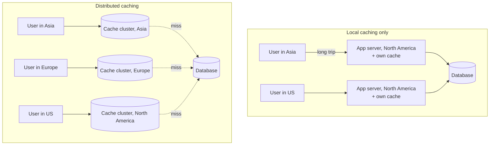
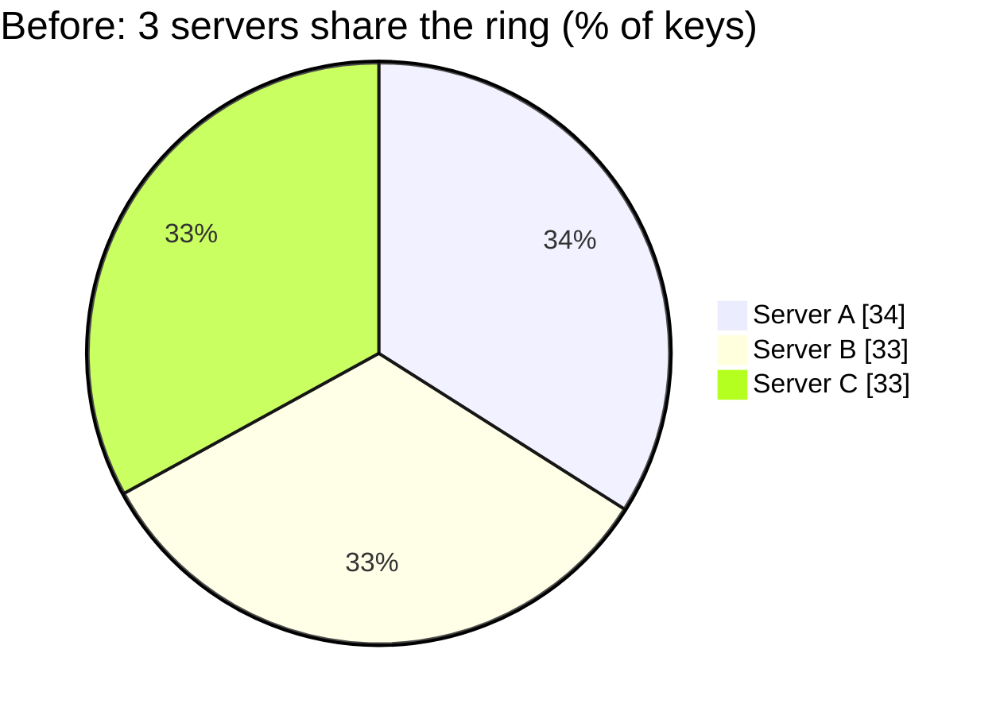
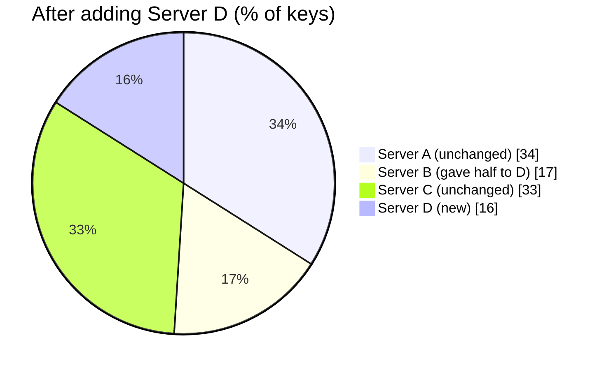
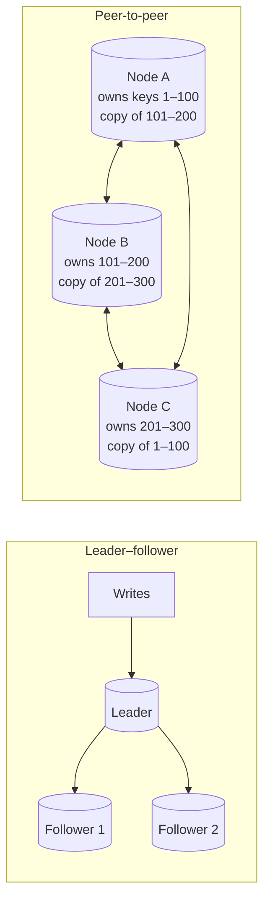

# Distributed Caching

> [!IMPORTANT]
> **📌 Key takeaway:** a distributed cache spreads cached data across many cache servers, often in several regions, so the cache can grow, survive a server failure, and sit close to users.
>
> - A local cache lives on one machine; once you have many servers or users in many regions, it causes stale data, duplicate copies and slow far-away reads.
> - **Partitioning** (usually consistent hashing) decides which server holds each key; **replication** keeps extra copies so a failed server doesn't lose data.
> - Interview line: "Partition with consistent hashing, replicate each key, evict with LRU or TTL, and watch the hit rate."

📅 **Date:** 2026-11-10

📚 **Resources:**

- [Redis glossary: Distributed Caching](https://redis.io/glossary/distributed-caching/)
- Background: my [Caching](caching.md) note (layers, write policies, eviction).

## ✍️ In my own words

<!-- Write this yourself BEFORE reading the polished notes or asking AI.
     Pretend you're explaining it to a teammate in 30 seconds. 2–3 sentences. -->

_✏️ To be written by me._

## 🗺️ Diagram

**Local vs distributed.** With only local caches, a user in Asia waits on a server in North America, and each server keeps its own (possibly different) copy. With a distributed cache, every region has cache servers and users read from the nearest one.

**Text version:** with local caching only, each app server has its own cache (duplicated, possibly out of sync) and far-away users wait on a distant server. With distributed caching, cache clusters run in several regions, users read from the nearest one, and only misses go to the database.

## 🔑 Key ideas

- **Local cache:** data cached on one machine or inside one app (browser cache, an in-memory map in the app). Fine for one server or small data.
- **Distributed cache:** data cached across many machines over a network, acting like one big cache. Needed when the app runs on many servers or serves users worldwide.
- **Why local caching breaks at scale:** if one server updates its local cache and the others don't know, users get **outdated data**; every server stores its own copy; and users far from the server wait longer.
- **Three benefits of distributed caching:**
  1. **Scalability:** add cache servers as traffic grows, without downtime.
  2. **Fault tolerance:** if one cache server fails, requests go to another that has a copy.
  3. **Performance:** data sits closer to users, so responses are faster.
- **Partitioning** = which server owns which key. **Replication** = how many servers keep a copy of each key. You almost always need both.

### Partitioning: consistent hashing

The simple way, `server = hash(key) % N`, breaks when N changes: add one server and almost every key moves to a different server, so the cache is suddenly empty (a flood of misses). **Consistent hashing** fixes this.

Think of the ring as a clock face. Each server owns the slice of the ring just before it, and every key in that slice is stored on that server. Adding Server D between A and B only splits **B's** slice; A's and C's keys don't move.

**Text version:** each server and each key gets a spot on a ring from its hash, and a key belongs to the next server clockwise. Before: A, B and C each own about a third of the keys. After adding D between A and B, D takes half of B's slice (16% of keys); A's and C's keys stay where they were. With `hash % N`, going from 3 to 4 servers would move about 75% of keys instead.

| Method | How a key finds its server | When a server is added or removed |
|---|---|---|
| Modulo hashing (`hash % N`) | Divide the hash by the number of servers | Almost **all** keys move: mass cache misses |
| Consistent hashing | Next server clockwise on a hash ring | Only about **1/N** of the keys move |
| Consistent hashing + **virtual nodes** | Each server gets many spots on the ring; bigger servers get more | Same small movement, and load stays even, even when servers have different sizes |

### Replication: keeping extra copies

**Text version:** in leader–follower, one leader takes writes and copies them to followers. In peer-to-peer, every node owns some keys and also keeps copies of other nodes' keys.

| Strategy | How it works | Pros | Cons |
|---|---|---|---|
| **Leader–follower** (the page says "master-slave") | One leader takes writes; followers keep copies and can serve reads | Simple; one place for writes, so fewer conflicts | Leader is a bottleneck for writes; need failover if it dies |
| **Peer-to-peer** | Every node owns some keys and holds replicas of others | No single leader; any node can take over | More complex; copies can disagree for a short time |

**Example from the page:** a social media app spreads user profiles across cache servers with consistent hashing, serves a European user from a European cache server, and keeps each profile on 2+ servers so a replica can answer if one fails.

## 🧪 Examples

| Solution | What it is | Strengths | Good fit |
|---|---|---|---|
| **Redis** | In-memory data structure store (strings, hashes, lists, sets); also a database and message broker | Rich data types, replication, optional persistence to disk | Most general-purpose caching; sessions, leaderboards, rate limits |
| **Memcached** | Simple distributed memory cache for key-value pairs | Very simple and fast; many connections at once | Plain key-value caching to take load off a database |
| **Hazelcast** | In-memory data grid: caching, messaging and computing | Built-in partitioning and replication; cloud-native | Java-heavy systems that also want distributed computing |
| **Apache Ignite** | In-memory computing platform | ACID transactions, SQL-style queries, persistence | When the cache also needs transactions or queries |

**Examples from the page:**

- **E-commerce:** product details cached in several regions so each shopper reads from the nearest cache server.
- **Streaming platform:** for a big movie release, movie metadata is partitioned across Redis servers in several regions, listings refresh with a TTL (Time To Live), and the team watches the hit rate during the traffic spike.

**From my own work:**

<!-- Compare with the registration page in caching.md: was that cache local or distributed? -->

- _✏️ To be written by me._

## 🎯 When to use it

- The app runs on **many servers** behind a load balancer and they must see the **same** cached data.
- Users are **spread across regions** and need low latency everywhere.
- The data to cache is **too big for one machine's memory**.
- The cache must **stay up when a server fails**.
- **Stick with a local cache** when there's one server, the data is small, or each user only needs their own data (like the browser).

### How to set one up (5 steps from the page)

1. Pick a solution that fits your requirements and infrastructure.
2. Install and configure it on each node.
3. Choose a partitioning and replication strategy.
4. Point the app's reads and writes at the cache.
5. Monitor and tune it.

**Best practices:** evict with LRU (Least Recently Used) or TTL so data stays fresh, keep the cache consistent with the database for data that changes often, track hit and miss rates, and design so you can add nodes later.

## ⚖️ Trade-offs

| Aspect | Local cache | Distributed cache |
|---|---|---|
| Speed per read | Fastest: in the same process, no network | Fast, but adds a network hop (~0.5 ms in the same data center) |
| Consistency across servers | Each server has its own copy; copies can disagree | One shared view of the data |
| Capacity | Limited to one machine's memory | Grows by adding nodes |
| Failure | Lost when the server restarts | Survives node failures if replicated |
| Duplication | Same data stored on every server | Each key stored once (plus replicas) |
| Geography | Only as close as the one server | Cache servers in each region, near users |
| Complexity and cost | Simple, free | More servers, networking, monitoring |

**Common middle ground:** a small local cache for the hottest keys **in front of** a distributed cache (two levels, like CPU L1 and L2).

## ☁️ On AWS

- **ElastiCache** (Redis OSS, Valkey or Memcached): managed distributed cache. Redis/Valkey "cluster mode" partitions data into shards, each with a primary and replicas.
- **MemoryDB**: Redis-compatible and durable, for when the cache is also the main store.
- **DAX (DynamoDB Accelerator)**: a managed cache cluster in front of DynamoDB.
- **ElastiCache Global Datastore**: copies a Redis/Valkey cache to other AWS Regions, so users read from the nearest one.

## 🛠️ Try it

- [ ] Task: in a few lines of Python, put 1,000 keys on 3 "servers" with `hash(key) % 3`, then switch to `% 4` and count how many keys moved. Then do the same with a simple consistent-hashing ring (sorted list of server hashes + `bisect`) and compare.
- What I saw:

## 🎤 Interview one-liner

> "Once an app runs on many servers or in many regions, local caches go stale and duplicate data, so I'd use a distributed cache like Redis or Memcached. I'd partition keys with consistent hashing so adding a node only moves a small share of keys, replicate each key to at least one more node for fault tolerance, evict with LRU plus a TTL, and monitor the hit rate."

## 🧠 Self-check

1. Why is `hash(key) % N` a bad way to pick a cache server?
   

Answer

   When N changes (a server is added or fails), almost every key maps to a different server, so the cache is effectively emptied and the database gets a flood of misses. Consistent hashing moves only about 1/N of the keys.

   

2. What problem do virtual nodes solve?
   

Answer

   Uneven load. Giving each server many spots on the hash ring (more spots for bigger servers) spreads keys evenly, even when servers have different capacities.

   

3. One cache node dies. What keeps users from losing that data, and what happens without it?
   

Answer

   Replication: another node holds a copy and takes over. Without replicas, every key on that node becomes a miss and must be re-read from the database.

   

## 🔗 Related topics

- [Caching](caching.md)
- [Horizontal vs Vertical Scaling](horizontal-vs-vertical-scaling.md) (a distributed cache scales out)
- [Database Types](database-types.md) (Redis and Memcached are in-memory key-value stores)
- Data Replication (not written yet)
- Database Sharding (not written yet; same partitioning idea, applied to databases)

## ❓ Questions I still have

- Redis Cluster uses 16,384 "hash slots" instead of a classic hash ring. How is that different from consistent hashing?
- How do you keep caches in several regions consistent when the data changes?
- With peer-to-peer replication, what happens when two nodes disagree about a value?

## 🔁 Review log

| Date | What I added or changed |
|---|---|
| 2026-11-10 | First notes |
