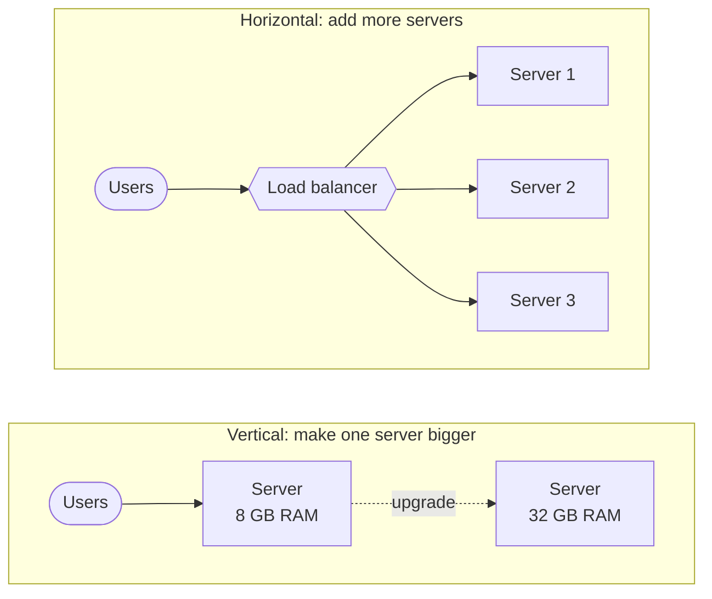
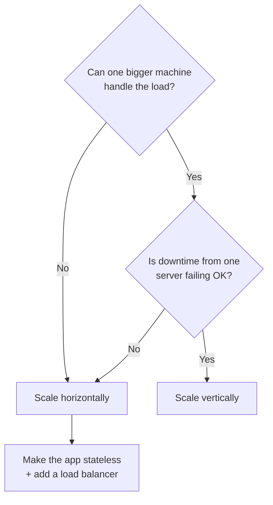

# Horizontal vs Vertical Scaling

> [!IMPORTANT]
> **📌 Key takeaway:** vertical scaling makes one machine bigger; horizontal scaling adds more machines behind a load balancer.
>
> - Vertical is simple, but it has a ceiling and a single point of failure.
> - Horizontal scales further and adds redundancy, but the app must be stateless.
> - Real systems mix both: scale web servers out, and often scale the database up first.

📅 **Date:** 2026-11-06

📚 **Resources:**

- [GeeksforGeeks: Horizontal and Vertical Scaling](https://www.geeksforgeeks.org/system-design/system-design-horizontal-and-vertical-scaling/)
- The original task link didn't work, so I used this one instead.

## ✍️ In my own words

<!-- Write this yourself BEFORE reading the polished notes or asking AI.
     Pretend you're explaining it to a teammate in 30 seconds. 2–3 sentences. -->

_✏️ To be written by me._

## 🗺️ Diagram

**Text version:**

- **Vertical:** users → one server. To handle more load, upgrade that server (8 GB → 32 GB of RAM).
- **Horizontal:** users → load balancer → server 1, 2 or 3. To handle more load, add another server.

## 🔑 Key ideas

- **Vertical scaling (scale up):** add more CPU, RAM or storage to the **same** server.
  - Easy: the app usually doesn't need to change.
  - Has a ceiling: you can only buy a machine so big.
  - Still one machine, so if it goes down, everything goes down.
- **Horizontal scaling (scale out):** add **more** servers and spread the work across them.
  - A **load balancer** sends each request to one of the servers.
  - No hard ceiling: keep adding servers as traffic grows.
  - Harder: the app must work across many machines (shared sessions, keeping data in sync).
- **Scaling is not the same as reliability.** Adding capacity doesn't automatically make a system fault tolerant. Horizontal scaling makes redundancy *possible*, but you still have to design for it.
- **Most real systems mix both**, choosing per component. For example: scale the web servers out, and scale the database up.

## 🧪 Examples

- **Vertical:** a small app is slow, so you upgrade its server from 8 GB to 32 GB of RAM.
- **Horizontal:** an online store adds more web servers before a big sale, then removes them afterward.
- **Analogy:** vertical = replacing your car with a bigger truck. Horizontal = adding more cars to the fleet.

**From my own work:**

- <!-- Add a real example: did a service you worked on scale out with more ECS tasks, or did you resize an instance? -->_✏️ To be added by me._

## 🎯 When to use it

**Text version:** if one bigger machine can't handle the load, scale horizontally. If it can, ask whether one server failing is acceptable: yes means scale vertically, no means scale horizontally. Horizontal scaling needs a stateless app and a load balancer.

**Vertical when:**

- The system is small or medium, and one bigger machine can handle the load.
- You need more capacity **quickly** with minimal changes.
- The component is hard to split, like a traditional relational database.

**Horizontal when:**

- Traffic could outgrow any single machine.
- You need **redundancy**, so one server failing doesn't take the site down.
- Traffic goes up and down, so you want to add and remove capacity (elastic).
- The app is **stateless**, meaning any server can handle any request.

## ⚖️ Trade-offs

| Aspect | Vertical (scale up) | Horizontal (scale out) |
|---|---|---|
| How | Bigger machine | More machines |
| Limit | Biggest machine available | Add nodes as needed |
| Complexity | Low | Higher (load balancing, data sync) |
| Failure | One machine is a single point of failure | Can survive a node failing |
| Downtime | Upgrades may need a restart | Add nodes without downtime |
| Cost | Gets expensive fast at the high end | Grows step by step |

## ☁️ On AWS

- **Vertical:** change an EC2 (Elastic Compute Cloud) instance type, for example `t3.medium` → `m5.xlarge`, or move an RDS (Relational Database Service) database to a larger instance class.
- **Horizontal:** an **Auto Scaling group** of EC2 instances behind an **Application Load Balancer (ALB)**, and **RDS read replicas** to spread read traffic.
- **Managed services that scale out for you:** DynamoDB, S3 (Simple Storage Service) and Lambda handle horizontal scaling automatically.

## 🛠️ Try it

- [ ] Task: in the AWS console, look at an EC2 instance's "Change instance type" option (vertical), then read how an Auto Scaling group adds instances (horizontal). No need to launch anything paid.
- What I saw:

## 🎤 Interview one-liner

> "Vertical scaling means upgrading one machine. It's simple but has a ceiling and a single point of failure. Horizontal scaling means adding machines behind a load balancer. It scales further and allows redundancy, but the app has to be stateless and data has to stay consistent. In practice I'd scale stateless web servers horizontally and often scale the database vertically first, adding read replicas or sharding when one machine isn't enough."

## 🧠 Self-check

1. Your single server is maxed out, and the app can't go down even for a restart. Which scaling?
   

Answer

   Horizontal: add servers behind a load balancer, so you add capacity without downtime and survive one server failing.

   

2. What must be true about an app before you can scale it horizontally?
   

Answer

   It should be stateless, so any server can handle any request. Sessions go in a shared store like Redis.

   

3. Name one AWS way to scale up and one to scale out.
   

Answer

   Up: change the EC2 instance type or RDS instance class. Out: an Auto Scaling group behind an Application Load Balancer, or RDS read replicas.

   

## 🔗 Related topics

- [Database Types](database-types.md)
- Load Balancing (not written yet)
- Database Sharding (not written yet)

## ❓ Questions I still have

- How do you keep user sessions working when requests hit different servers? (Sticky sessions vs. storing sessions in Redis.)
- When does a database need sharding instead of a bigger machine? (Future note: Database Sharding.)

## 🔁 Review log

| Date | What I added or changed |
|---|---|
| 2026-11-06 | First notes |
