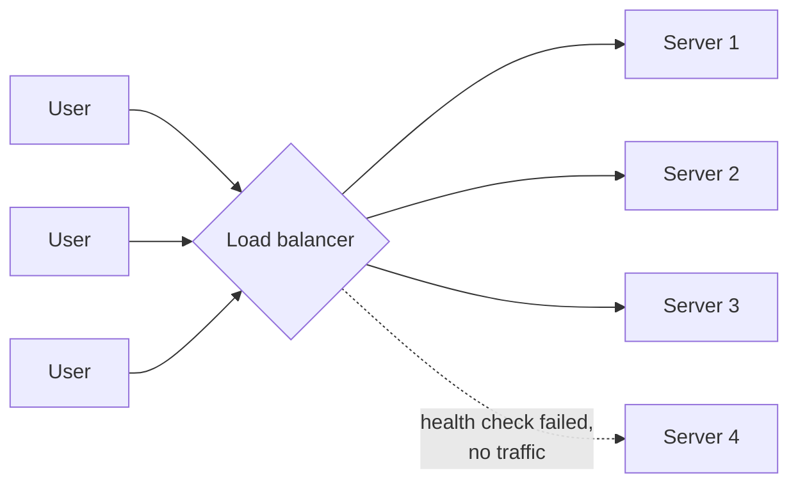

# Load Balancing

> [!IMPORTANT]
> **📌 Key takeaway:** a load balancer sits between users and a group of servers and sends each request to the server best able to handle it, so no single server gets overloaded.
>
> - It improves availability (skips failed servers), scalability (add or remove servers), security (absorbs DDoS) and performance (spreads load, picks a closer server).
> - Algorithms are **static** (fixed rules: round-robin, weighted round-robin, IP hash) or **dynamic** (check server state: least connections, least response time, resource-based).
> - Application load balancers read the request content (HTTP headers); network load balancers only look at IP addresses and ports.

📅 **Date:** 2026-11-21

📚 **Resources:**

- [AWS: What is Load Balancing?](https://aws.amazon.com/what-is/load-balancing/)

## 🗺️ Diagram

**Text version:** all users talk to one load balancer, never to a server directly. The load balancer forwards each request to one healthy server in the server farm. A server that fails its health check stops getting traffic until it recovers.

## 🔑 Key ideas

- **Server farm:** many servers holding the same data and code. The load balancer makes them look like one service.
- **Restaurant analogy:** if customers picked their own waiters, some waiters would be swamped while others stood idle. The manager (load balancer) assigns each customer to the best waiter.
- **Health checks:** the load balancer keeps checking each server and stops sending traffic to one that fails. This is what lets you do maintenance or upgrades with no downtime.

### Algorithms

| Type | Algorithm | How it picks a server |
|---|---|---|
| Static | **Round-robin** | Takes turns: server 1, 2, 3, 1, 2, 3… (often done by a DNS name server handing out IPs in turn) |
| Static | **Weighted round-robin** | Takes turns, but bigger servers (higher weight) get more turns |
| Static | **IP hash** | Hashes the client's IP address to a number that maps to one server, so the same client usually lands on the same server |
| Dynamic | **Least connections** | Server with the fewest open connections (assumes every connection costs the same) |
| Dynamic | **Weighted least connections** | Fewest connections compared to the server's capacity |
| Dynamic | **Least response time** | Combines response time and open connections; picks the fastest |
| Dynamic | **Resource-based** | An agent on each server reports free CPU and memory; the server with enough free resources wins |

### Types of load balancing

| Type | What it looks at | Example |
|---|---|---|
| **Application** (Layer 7) | Request content: HTTP headers, URL, SSL session IDs | Online shop: browsing requests go to image/video servers; cart requests go to servers that hold long-lived connections and cart data |
| **Network** (Layer 4) | IP addresses and ports | Many servers share one static IP; fast, works for TCP and UDP |
| **Global server** (GSLB) | The user's location | Servers in several data centers or countries; traffic goes to the closest region, and to another region only if a server fails |
| **DNS** | The domain name | The domain answers with different IP addresses from a pool of resources |

### Hardware vs software

| Aspect | Hardware load balancer | Software load balancer |
|---|---|---|
| What it is | A physical appliance in your data center | An app on any server, or a managed service |
| Cost | Large up-front cost plus maintenance | Cheaper to set up and run |
| Scaling | Fixed capacity; a spike beyond it hurts users until you buy more | Scales up or down easily |
| Fit | On-premises | Cloud |

## 🧪 Examples

- **Code.org** used an Application Load Balancer to handle a 400% traffic spike during online coding events.
- **Terminix** used a Gateway Load Balancer to handle 300% more throughput.
- **Nginx or HAProxy** in front of a few web servers is the classic software load balancer you can run yourself.

## 🎯 When to use it

- You have **more than one server** for the same app (horizontal scaling needs a load balancer).
- You need **no downtime** during deploys, maintenance or a server failure.
- You want to **route by path or header** (`/api` to one group, `/images` to another) → application load balancer.
- You need **raw speed for TCP or UDP** (games, streaming, IoT) or a static IP → network load balancer.
- You serve users **in several regions** → global server or DNS load balancing.

## ⚖️ Trade-offs

| Aspect | Static algorithms | Dynamic algorithms |
|---|---|---|
| Speed of deciding | Very fast, no state to track | Slower, must track server state |
| Fairness | Uneven if requests or servers differ | Adapts to real load |
| Complexity | Simple | Needs connection counts, timings or agents |
| Sticky clients | IP hash keeps a client on one server | Usually not sticky |

## ☁️ On AWS

**ELB (Elastic Load Balancing)** is the managed service. It has four types:

- **ALB (Application Load Balancer):** HTTP and HTTPS, Layer 7, routes by path, host or header.
- **NLB (Network Load Balancer):** TCP and UDP, Layer 4, routes by IP address, very high throughput.
- **GWLB (Gateway Load Balancer):** sends traffic through third-party virtual appliances like firewalls.
- **CLB (Classic Load Balancer):** the old type, for the retired EC2-Classic network.

## 🎤 Interview one-liner

> "A load balancer sits in front of my servers and spreads requests across them, skipping any server that fails its health check. For web traffic I'd use a Layer 7 application load balancer that can route by URL or header; for raw TCP or UDP a Layer 4 network load balancer. I'd start with round-robin or least connections, and use IP hash or sticky sessions only if the servers can't be stateless."

## 🧠 Self-check

1. Your servers are all the same size but some requests take 10× longer than others. Round-robin or least connections?
   

Answer

   Least connections. Round-robin ignores how busy a server is, so slow requests can pile up on one server. Least connections sends new requests to the server with the fewest open ones.

   

2. You want `/api/*` to go to one server group and `/images/*` to another. Which type of load balancer?
   

Answer

   An application (Layer 7) load balancer, because it reads the request URL. A network (Layer 4) load balancer only sees IP addresses and ports.

   

3. A load balancer makes the app servers highly available. What's the new risk, and how is it fixed?
   

Answer

   The load balancer itself becomes a single point of failure. Fix it by running more than one (active-passive or active-active), which managed services like ELB do for you across availability zones.

   

## 🔗 Related topics

- [Horizontal vs Vertical Scaling](horizontal-vs-vertical-scaling.md) (scaling out needs a load balancer)
- [Caching](caching.md) (local caches behind a load balancer cause more misses)
- [Distributed Caching](distributed-caching.md) (consistent hashing, a smarter cousin of IP hash)
- Proxy Server (not written yet; a load balancer is a kind of reverse proxy)

## ❓ Questions I still have

- How do sticky sessions work, and why do they make scaling harder?
- How do health checks decide a server is "unhealthy" (interval, timeout, thresholds)?
- What happens to open connections when a server is removed (connection draining)?

## 🔁 Review log

| Date | What I added or changed |
|---|---|
| 2026-11-21 | First notes |
